<div align="center">
  
</div>

<br>

<p align="center">
  <a href="https://github.com/zeiad6/zeidex-convert-android/releases/latest"></a>
  
  
  
  
  
</p>

<p align="center">
  <b><a href="https://github.com/zeiad6/zeidex-convert-android/releases/latest">⬇︎ تحميل APK — 1.3.0</a></b>
  &nbsp;·&nbsp;
  <a href="RELEASING.md">دليل الإصدار</a>
  &nbsp;·&nbsp;
  <a href="#english">English</a>
</p>

<div dir="rtl" align="right">

رفيق **Zeidex Convert** على الهاتف: يقرأ المستند ويكتبه على الجهاز، بلا رفع ولا حساب ولا طلب شبكة واحد. مكتوب بـ Kotlin و Jetpack Compose، ويعمل مع تطبيق سطح المكتب عبر **LocalDrop** على شبكة Wi-Fi المحلية.

## ما الجديد في 1.3.0

النسخة 1.2.0 كانت ترفض ملفات xlsx و docx برسالة «حوّله على تطبيق سطح المكتب». الآن **أي مستند يُقرأ داخل الهاتف ويُكتب PDF**، بمحلّلات مكتوبة داخل المشروع: لا Apache POI، ولا PDFBox، ولا مكتبة تحويل خارجية.

| الميزة | التفصيل |
|---|---|
| PDF حقيقي | نص قابل للتحديد والبحث، ترقيم صفحات تلقائي، رأس جدول مظلّل، شبكة خلايا، وأوراق عريضة تُقلَب أفقياً |
| عربية سليمة | التشكيل بخطوط النظام عبر `StaticLayout`، لا بخط لاتيني وحده |
| قيم لا مظهر | الأرقام والتواريخ والعملات من `xl/styles.xml`، فما تراه في Excel هو ما يظهر في PDF |
| رسائل صادقة | ممسوح ضوئيًا بلا طبقة نصية يُبلَّغ عنه برسالة OCR، وHTML إلى TXT يُخرج النص وحده |

## الصيغ

| المُدخَل | ما يُقرأ | المُخرَج |
|---|---|---|
| PDF | نص الصفحات | PNG، JPG، DOCX، TXT، ZIP |
| DOCX | فقرات وعناوين وجداول | PDF، DOCX، TXT، Markdown |
| XLSX · XLSM · ODS · CSV · TSV | أوراق وقيم وتواريخ | PDF بجداول مرسومة، DOCX، TXT |
| PPTX | شرائح وعناوينها | PDF، DOCX، TXT |
| ODT · RTF · HTML · EPUB | نص منسّق | PDF، DOCX، TXT، Markdown |
| SRT · VTT · ASS | ترجمات | SRT، VTT، ASS، TXT |
| PNG · JPG · WEBP · BMP · ICO | صور وبيانات وصفية | JPG، PNG، WEBP، BMP، PDF، ICO، ZIP |
| MP4 · M4A · WAV | فيديو وصوت | MP4 بلا إعادة ترميز، M4A، ZIP |
| ZIP · TAR | أرشيف | استخراج، ZIP |

أربعة عشر امتدادًا للمستندات، ونموذج واحد في المنتصف: فقرات وجداول. كل ما يخرج يُكتب من النموذج نفسه، فالتحويل من أي مستند إلى PDF وDOCX مسار واحد لا مسارات متفرقة.

</div>

<p align="center">
  
</p>

<div dir="rtl" align="right">

## كيف يعمل

| المرحلة | ما يحدث |
|---|---|
| قراءة | التعرّف على الصيغة من البايتات الأولى لا من الامتداد، ثم تفويض القراءة إلى محلّل واحد مخصّص لكل صيغة |
| نموذج | الناتج قائمة كتل — فقرة، عنوان، جدول، صورة — بلا أي اعتماد على Android، ولهذا تُختبر المحلّلات على JVM بلا محاكي |
| كتابة | PDF يُرسم بـ`PdfDocument` و`StaticLayout`، وDOCX يُبنى كـOOXML، والنص وMarkdown يُكتبان مباشرة |

## الحدود المقصودة

| الحالة | ما يحدث |
|---|---|
| صيغ Office 97-2003 الثنائية | لا تُقرأ على الجهاز؛ الرسالة تطلب حفظها بصيغة حديثة أو تحويلها على سطح المكتب |
| ملفات iWork | تحتاج تصديرًا مسبقًا إلى PDF أو DOCX |
| PDF ممسوح ضوئيًا | يحتاج OCR في التطبيق المكتبي؛ لا يُنتج ملفًا فارغًا |
| XLSX ضخم | قراءة حتى 20,000 صف و120,000 خلية و128 عمودًا، وتصدير أول 5,000 صف مع ذكر الباقي |
| PPTX وDOCX | النصوص والعناوين والجداول؛ الصور والأشكال والأنماط المعقّدة تُبسَّط |

## التحديثات والتوقيع

قبل التثبيت يُفحص كل تحديث ببصمة SHA-256 كاملة من ملف البيان، وببصمة شهادة التوقيع الرسمية. وأي اختلاف يعني رفض الحزمة لا تثبيتها. الحزم الموقّعة تُبنى في CI من وسم وتُرفع مع ملف البصمات، والخطوات كاملة في [دليل الإصدار](RELEASING.md).

</div>

<p align="center">
  
</p>

## البناء

```bash
./gradlew :app:testDebugUnitTest
./gradlew :app:assembleDebug
./gradlew :app:assembleRelease
```

<div dir="rtl" align="right">

الأول يشغّل 57 اختبار وحدة على JVM بلا محاكي، والثاني يبني APK للتطوير، والثالث يوقّع حزمة الإصدار ويحتاج مفتاح توقيع في `keystore/release.keystore` غير مرفوع إلى المستودع، وفي CI يصل عبر أسرار المستودع. المطلوب: JDK 17 و Android SDK 35، وأقل إصدار مدعوم Android 8.0 (API 26).

## البنية

</div>

```
app/src/main/java/com/zeidex/convert/
├── engine/      document readers, PDF writer, media, LocalDrop, QR
├── model/       Format, Category and the conversion rules
├── ui/          Compose screens, wheel, tasks, settings
├── util/        atomic writes, update verification, file helpers
└── work/        background jobs and progress
```

<div dir="rtl" align="right">

| المجلد | المسؤولية |
|---|---|
| `engine` | قراءة المستندات، كتابة PDF، الصور والفيديو، LocalDrop، QR |
| `model` | الصيغ وقواعد التحويل بينها |
| `ui` | شاشات Compose، العجلة، المهام، الإعدادات |
| `util` | الكتابة الذرية، التحقق من التحديثات، أدوات الملفات |
| `work` | مهام الخلفية والتقدّم |

## الرخصة

الرخصة MIT © 2026 Zeidexsoft — نفس ترخيص المشروع الأم.

</div>

---

## English

An offline Android companion for [Zeidex Convert](https://github.com/zeiad6/zeidexfileconventer). Version 1.3.0 reads DOCX, XLSX/XLSM, ODS, CSV, PPTX, ODT, RTF, HTML, EPUB and Markdown with parsers written in this repository, and writes a **PDF with selectable text** — pagination, drawn tables, landscape sheets, and Arabic shaping through the system fonts. No upload, no account, no network call.

Media, archives, images and subtitles convert on the device too; LocalDrop receives files from the desktop app over the LAN with a QR handshake and AES-256-GCM frames. Every update is checked against a full SHA-256 digest and the signing certificate fingerprint before it is installed.

Build with JDK 17 and Android SDK 35:

```bash
./gradlew :app:testDebugUnitTest
./gradlew :app:assembleDebug
```

Release signing, the pinned certificate and the update manifest rules are documented in [`RELEASING.md`](RELEASING.md). Licensed MIT © 2026 Zeidexsoft.
